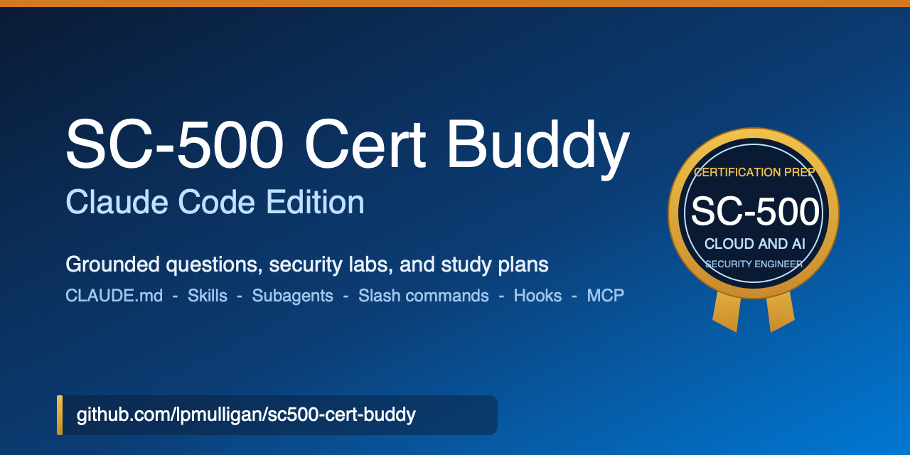

<!-- markdownlint-disable MD041 -->
<p align="center">
  
</p>
<!-- markdownlint-enable MD041 -->

<p align="center">

[](https://learn.microsoft.com/credentials/certifications/cloud-and-ai-security-engineer-associate/)
[](https://learn.microsoft.com/credentials/certifications/cloud-and-ai-security-engineer-associate/)
[](https://www.claude.com/product/claude-code)
[](https://learn.microsoft.com/)

</p>

# SC-500 Cert Buddy (Claude Code Edition)

An AI-powered study companion for **Exam SC-500: Implementing End-to-End Security Controls for Cloud and AI Workloads**, the exam for the **Microsoft Certified: Cloud and AI Security Engineer Associate** certification, built natively for **Claude Code**. There is no application code here. The artifacts are a memory file, subagents, slash commands, Agent Skills, hooks, and an MCP server configuration that together turn Claude Code into an interactive exam coach.

The buddy generates **exam-realistic practice questions** with two-phase answer evaluation, **short hands-on security labs** with a license and cost gate, validation gates, and cleanup, and **personalized study plans** based on your self-assessed confidence and the licenses you can lab with. Every piece is original and grounded in **Microsoft Learn** through the free **Microsoft Learn MCP server**.

## Credits

This repository is an SC-500 adaptation of **[AI-901 Cert Buddy (Claude Code Edition)](https://github.com/timothywarner-org/ai901-cert-buddy-claude)** by **Tim Warner** ([TechTrainerTim.com](https://TechTrainerTim.com)), which ported his GitHub Copilot Cert Buddy to Claude Code one primitive at a time. The architecture, the primitive map, the hooks, the FastMCP server, and the WWL exam-writing discipline are Tim's work, used under the MIT License. The SC-500 objective domain, lab license matrix, skills, and question content are new.

## Azure knowledge prerequisites

SC-500 is an associate-level exam. Microsoft expects practical experience administering Azure and hybrid environments (compute, network, and storage), strong familiarity with Microsoft Entra ID, and familiarity with Microsoft 365 administration. If virtual networks, VMs, storage accounts, or Azure RBAC are new to you, ramp on those first.

## Prerequisites

| Requirement | Purpose |
| --- | --- |
| **Claude Code** | Runs the buddy: the subagents, slash commands, skills, and hooks |
| **Python 3** (`python3`) | Runs the hook scripts in `.claude/hooks/` and the local `cert-buddy` MCP server |
| **Lab Azure subscription and lab tenant** | Needed only for the practice labs. Never run labs against production. |
| **Premium licenses or trials** | Optional. Some labs need Microsoft Entra ID P1 or P2, Microsoft 365 E5, Microsoft Agent 365, or Security Copilot capacity. Every lab tells you up front. |

No API keys are required. The Microsoft Learn MCP server is a free hosted service with no sign-up.

## Quick start

1. Clone the repository:

   ```bash
   git clone https://github.com/lpmulligan/sc500-cert-buddy.git
   ```

2. Install the local server dependency once:

   ```bash
   cd sc500-cert-buddy
   python3 -m venv mcp-server/.venv
   mcp-server/.venv/bin/pip install -r mcp-server/requirements.txt
   ```

3. Open the folder in Claude Code:

   ```bash
   claude
   ```

4. Claude Code auto-loads `CLAUDE.md`, the subagents, the slash commands, the skills, the hooks, and the `.mcp.json` servers. Approve the project MCP servers `mslearn` and `cert-buddy` when prompted. Neither needs an API key.

5. Start studying:

   ```text
   /quiz domain=storage-network difficulty=medium
   ```

### Verify setup

After opening the folder, confirm the MCP servers connected:

1. Run `/mcp` in Claude Code.
2. Confirm that `mslearn` and `cert-buddy` show as connected.

If either fails to connect, see [Troubleshooting](#troubleshooting).

## How to use it

You drive the buddy with five slash commands. Each one routes to the **sc500-cert-buddy** subagent and the right skill.

| Command | What it does |
| --- | --- |
| `/quiz [count=5] [domain=...] [bloom=...] [difficulty=...]` | A short quiz (default 5 questions), one at a time with progress and an end-of-quiz score. Use `count=1` for a single question |
| `/lab [objective or topic]` | A short, self-validating security lab with a license and cost gate and a mandatory cleanup step, saved as a gradable document |
| `/grade [lab slug]` | Grades your recorded lab results against the lab answer key |
| `/plan [confidence per domain]` | A personalized study plan ordered weakest to strongest, with Microsoft Learn module links and lab status |
| `/explain [concept]` | A first-principles explanation grounded in Microsoft Learn |

Domain keys: `identity`, `storage-network`, `compute`, `posture`.

### Practice questions

The question flow has two phases:

1. **Phase 1, question.** The buddy presents metadata (domain, objective, Bloom level), a scenario stem, and four answer choices (A-D). It does **NOT** reveal the correct answer.
2. **You answer.** Type your choice (for example, "B").
3. **Phase 2, evaluation.** The buddy tells you whether you were correct, reveals the answer, gives a two-sentence rationale for every choice, and lists Microsoft Learn references.

```text
/quiz domain=identity difficulty=hard
/quiz domain=compute bloom=Analyze
```

### Practice labs

Every SC-500 objective has a lab, including the ones that need a premium license. Each lab opens with a **license and cost gate** that lists what you need (for example, Microsoft Entra ID P2 for PIM, or Defender for Servers Plan 2 for JIT VM access), any free trial, and the cleanup step that stops the cost. Labs that need a premium license also include a **no-license path**, so you can still study the objective. The full matrix is in [`.claude/skills/_references/sc500-lab-requirements.md`](.claude/skills/_references/sc500-lab-requirements.md).

```text
/lab 3.2.3
/lab Azure Virtual Network Manager security admin rules
```

### Study plans

```text
/plan
/plan identity=strong storage-network=weak compute=moderate posture=unknown
```

The buddy presents the four SC-500 domains with exam weights, asks you to rate your confidence and which licenses you can lab with, then builds a prioritized plan with estimated hours, Microsoft Learn module links, and lab status for each of the 12 sub-areas.

## The port, primitive by primitive

Every headline GitHub Copilot primitive has a one-to-one Claude Code counterpart. That mapping, from the upstream project, is the reference value of this repo's structure.

| GitHub Copilot primitive | Claude Code primitive | Where it lives here |
| --- | --- | --- |
| `.github/copilot-instructions.md` | **CLAUDE.md** (always-on memory) | `CLAUDE.md` |
| `.github/agents/*.agent.md` | **Subagent** | `.claude/agents/sc500-cert-buddy.md` |
| (none) | **Subagent** (verifier) | `.claude/agents/grounding-verifier.md` |
| `.github/prompts/*.prompt.md` | **Slash command** | `.claude/commands/{quiz,lab,grade,plan,explain}.md` |
| `.github/skills/*/SKILL.md` | **Agent Skill** | `.claude/skills/sc500-*/SKILL.md` |
| `.vscode/mcp.json` | **Project MCP** | `.mcp.json` |
| CI greps | **Hooks** | `.claude/settings.json` + `.claude/hooks/*.py` |
| (none) | **Plugin and marketplace** | `.claude-plugin/` |

## Subagents

The buddy uses three subagents in `.claude/agents/`:

- **sc500-cert-buddy** is the orchestrator. It grounds, reads, and delegates to the three skills. Its tool list is deliberately short (the three Microsoft Learn MCP tools plus Read, Grep, and Glob), because a study agent that cannot run shell commands or edit files cannot harm your machine or your tenant.
- **grounding-verifier** is an independent checker with exactly two tools, Read and `microsoft_docs_fetch`. It re-fetches every cited URL, checks license claims, and flags any retired product name. Run it after generating an item or lab for a second opinion.
- **azure-principal-architect** is an optional pair architect for lab design, grounded in the Azure Well-Architected Framework.

## Skills

Three Agent Skills in `.claude/skills/`, auto-discovered by Claude Code from their `SKILL.md` frontmatter:

| Skill | Purpose |
| --- | --- |
| **sc500-item-creator** | Exam-realistic SC-500 practice questions following the Microsoft Worldwide Learning Exam Writing Style Guide, with randomized answer positions and fictional companies |
| **sc500-lab-creator** | Short hands-on security labs with a license and cost gate, validation gates, a no-license path, and cleanup |
| **sc500-study-planner** | Personalized study plans across the four SC-500 domains and 12 sub-areas |

Shared reference material the skills draw on lives in `.claude/skills/_references/`: the objective domain, the lab requirements matrix, the exam-writing rules, and the approved fictional companies.

## Hooks

Four hooks in `.claude/hooks/`, registered in `.claude/settings.json`, turn the buddy's promises into guarantees:

| Hook | Event | What it does |
| --- | --- | --- |
| `session-start.py` | SessionStart | Primes every session with the grounding and WWL rules |
| `prompt-context.py` | UserPromptSubmit | Keeps the grounding and WWL reminder in front of the model on every prompt |
| `policy-gate.py` | PreToolUse (Bash) | Blocks destructive shell commands before they run by returning a deny decision |
| `citation-audit.py` | PostToolUse (Microsoft Learn MCP) | Appends every grounding call and its returned URLs to `.cert-buddy/audit.log` |

The discipline behind them: if a guarantee has to hold, you hook it. A hook runs as your code, not the model's.

## MCP servers

Two Model Context Protocol servers are configured in `.mcp.json` and start when Claude Code loads the project.

| Server ID | Transport | Purpose |
| --- | --- | --- |
| `mslearn` | `https://learn.microsoft.com/api/mcp` (HTTP) | Free Microsoft Learn MCP server, no API key and no sign-up. Provides `microsoft_docs_search`, `microsoft_docs_fetch`, and `microsoft_code_sample_search`, which ground all content in official Microsoft documentation. |
| `cert-buddy` | `mcp-server/.venv/bin/python3 mcp-server/cert_buddy_mcp.py` (stdio) | Local FastMCP server for scoring, item validation, lab grading, progress, and quiz prompts. See [`mcp-server/README.md`](mcp-server/README.md). |

## Exam resources

| Resource | Link |
| --- | --- |
| Cloud and AI Security Engineer Associate certification | [Certification page](https://learn.microsoft.com/credentials/certifications/cloud-and-ai-security-engineer-associate/) |
| SC-500 study guide | [Study guide](https://learn.microsoft.com/credentials/certifications/resources/study-guides/sc-500) |
| Practice assessment | Not yet available as of 2026-10-20; Microsoft usually publishes one within eight weeks of an exam leaving beta |
| Schedule your exam | [Register and schedule](https://learn.microsoft.com/credentials/certifications/register-schedule-exam) |
| Exam policies and FAQs | [Exam policies](https://learn.microsoft.com/credentials/certifications/certification-exam-policies) |
| Microsoft Learn MCP server | [Documentation](https://learn.microsoft.com/training/support/mcp) |

## Key rules

The buddy enforces several non-negotiable rules across all generated content:

- **Current terminology only.** Retired product names are never used. Microsoft Entra ID replaces Azure AD, Microsoft Defender for Cloud replaces Azure Security Center, Microsoft Sentinel replaces Azure Sentinel, and so on. The rename table lives in `CLAUDE.md`.
- **Grounded in Microsoft Learn.** Every question and lab is grounded in official Microsoft Learn documentation through the MCP server before any other source. Microsoft Learn URLs are included as references.
- **Licenses stated up front.** Every lab opens with a license and cost gate, re-grounded in Learn because licensing changes often.
- **Lab safety.** Labs run only against a dedicated lab tenant and subscription. Conditional Access policies exclude a break-glass account and start in Report-only mode.
- **Original content only.** The buddy never recreates, paraphrases, or references real exam questions or leaked content. Every scenario is written from scratch.
- **No contractions.** Generated exam content avoids contractions, per the exam-writing style guide.
- **No trick wording.** Negative words are avoided; when necessary, they are capitalized and bolded.
- **Distractors must be real.** Wrong answer choices reference actual Microsoft security services, roles, and plans, never invented ones.
- **Labs include cleanup.** Every lab ends with steps that remove the resources it created and turn off the plans it enabled.
- **Answer randomization.** The correct answer position is randomized across A, B, C, and D.
- **Company randomization.** Fictional company names are drawn from the approved Microsoft list, not always Contoso, Ltd.

## Troubleshooting

| Problem | Cause | Fix |
| --- | --- | --- |
| `mslearn` fails to connect | Network connectivity | The server is hosted at `learn.microsoft.com/api/mcp`. Confirm you have internet access, then run `/mcp` to reconnect |
| `cert-buddy` fails to connect | Missing dependency | Create the repo venv (`python3 -m venv mcp-server/.venv`, then `mcp-server/.venv/bin/pip install -r mcp-server/requirements.txt`), then restart Claude Code |
| `cert-buddy` fails with `No module named 'mcp.server.fastmcp'` | MCP SDK 2.x installed | The server uses the 1.x API. Reinstall from `mcp-server/requirements.txt`, which caps `mcp` below 2.0 |
| Hooks do not fire | `python3` not on PATH | Confirm `python3` runs in your shell. On Windows, change `python3` to `python` or `py` in `.claude/settings.json` and `.mcp.json` |
| Slash commands do not appear | Project not loaded | Launch `claude` from inside the repository folder so `.claude/` is discovered |
| A skill is not used | Description mismatch | Skills are auto-selected from their `SKILL.md` description. Ask for the task directly, for example "quiz me on Conditional Access" |

## Repository structure

```text
sc500-cert-buddy/
  CLAUDE.md                          Memory: SC-500 facts, grounding rules, rename table
  .mcp.json                          Microsoft Learn MCP (HTTP, no key) and the local cert-buddy server
  .claude/
    settings.json                    Hook registration and permissions
    agents/
      sc500-cert-buddy.md            Orchestrator subagent
      grounding-verifier.md          Independent citation, license, and terminology checker
      azure-principal-architect.md   Optional pair architect for lab design
    commands/
      quiz.md  lab.md  grade.md  plan.md  explain.md
    skills/
      sc500-item-creator/SKILL.md    Exam question generation
      sc500-lab-creator/SKILL.md     Practice lab generation
      sc500-study-planner/SKILL.md   Personalized study plan generation
      _references/                   Objective domain, lab requirements, exam-writing rules, companies
    hooks/
      session-start.py               SessionStart: prime the rules
      prompt-context.py              UserPromptSubmit: keep the rules in front of the model
      policy-gate.py                 PreToolUse: deny destructive Bash
      citation-audit.py              PostToolUse: log Microsoft Learn grounding
    output-styles/cert-coach.md      Study-coach voice
  mcp-server/                        Local FastMCP server (tools, resources, prompts)
  labs/                              Saved gradable labs and the answer key schema
  plugin/sc500-cert-buddy/           Generated plugin package (do not edit by hand)
  .claude-plugin/marketplace.json    One-line install for learners
  scripts/                           Plugin build scripts
  images/                            Banner
  .editorconfig  .markdownlint.json  .gitignore
  CONTRIBUTING.md  SECURITY.md  CODE_OF_CONDUCT.md  LICENSE
```

## Install as a plugin

The whole buddy is packaged as an installable Claude Code plugin under `plugin/sc500-cert-buddy/`, generated from the project primitives by `scripts/build-plugin.sh` (or `scripts/build-plugin.ps1`). The marketplace manifest is `.claude-plugin/marketplace.json`.

```text
/plugin marketplace add lpmulligan/sc500-cert-buddy
/plugin install sc500-cert-buddy
```

Re-run the build script after editing any agent, command, skill, hook, or the MCP server, then commit.

## Gradable labs

`/lab` saves each lab as a gradable document under `labs/<slug>/`: a learner-facing `lab.md` plus a canonical `answer-key.json`. Record your results in `labs/<slug>/submission.json` and run `/grade <slug>`. The cert-buddy MCP tool `grade_lab` compares your submission against the key and returns a score with a per-check breakdown. If you followed a lab's no-license path, add `"_path": "no-license"` to your submission and the grader leaves the licensed checks out of the score. The schema is in [`labs/README.md`](labs/README.md).

New to the repo? Start with the [**TUTORIAL**](TUTORIAL.md) for a hands-on first fifteen minutes.

## Social preview

The banner at `images/sc500-cert-buddy.png` is sized 1280x640 to double as the GitHub social-preview card. To enable it, upload that file once under **Settings > General > Social preview** (GitHub does not expose this as a file in the repo).

## Help and support

- **Issues:** [Report a bug or request a feature](https://github.com/lpmulligan/sc500-cert-buddy/issues)
- **Contributing:** See [CONTRIBUTING.md](CONTRIBUTING.md)
- **Security:** See [SECURITY.md](SECURITY.md)
- **Maintainer:** Lawrence Mulligan ([@lpmulligan](https://github.com/lpmulligan))
